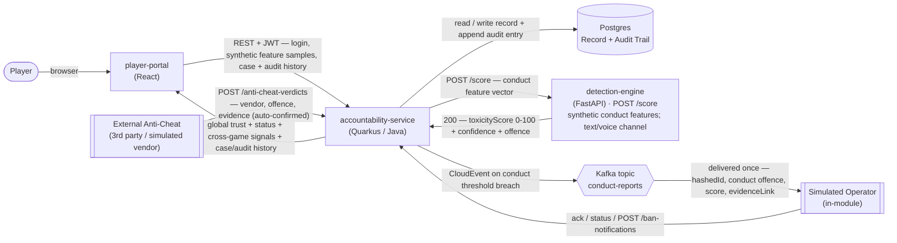
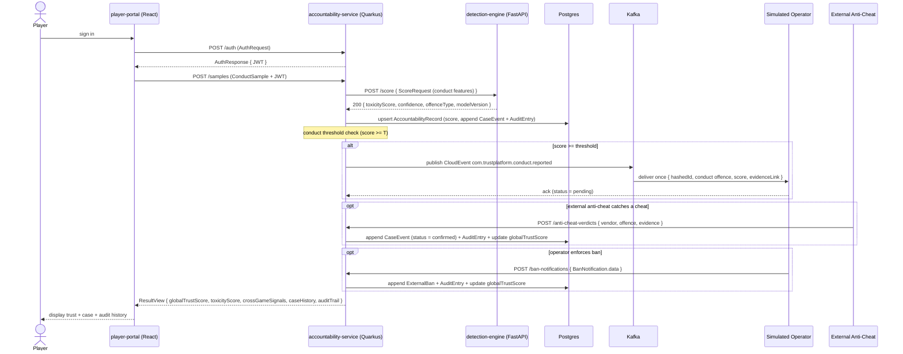

# Architecture Overview

One **monorepo**, three code modules plus the notes vault. Each module has one clear responsibility; they meet at three seams — a REST call to the **conduct scorer using synthetic feature vectors**, an **inbound anti-cheat verdict** hook, and Kafka events with the operator.

Identity model in one line: one verified platform profile links to multiple game/operator accounts, each account has its own audited case history, and one global trust score — fed by **in-house conduct detection** *and* **external anti-cheat verdicts** — spans all games.

~~~
   player-portal/ ──REST + JWT──▶  accountability-service/ ──POST /score──▶  detection-engine/
                             │                     ▲                         (synthetic text/voice feature rows)
                             │                     └── POST /anti-cheat-verdicts ◀── External Anti-Cheat
                             └──Kafka conduct-report──▶  Simulated Operator
~~~

## System diagram

Shows the three services, the two data stores, the external anti-cheat, and **what data travels on each connection**.

## Modules
- **[[ml-module]]** (Python) — **conduct-detection engine**: synthetic numerical-feature dataset, ≥3 models, calibrated toxicity score, `POST /score` API. No raw chat or audio is processed.
- **[[platform-module]]** (Quarkus/Java) — owns profile/account linking + [[Accountability-Record]] + **append-only audit trail** (Postgres+Flyway), keeps global trust, stores per-game case history, calls `/score` for conduct, **ingests external anti-cheat verdicts** ([[Anti-Cheat-Integration]]), emits the [[Cheat-Report-Event|conduct-report CloudEvent]], ingests operator ban outcomes, JWT/OIDC auth.
- **[[web-module]]** (React) — login, synthetic sample submission, results + case/audit history, appeals, and a mocked identity/age-assurance flow. Demonstrations use synthetic test accounts and are not connected to live games or real identity providers.

## Service interaction
1. `player-portal` →(REST + JWT)→ `accountability-service` — a demo account submits a synthetic conduct feature sample and requests results + audit history.
2. `accountability-service` →(POST /score)→ `detection-engine` — backend gets a calibrated 0–100 **conduct (toxicity) score** + conduct offence type.
3. `accountability-service` (internal) — updates the [[Accountability-Record]] in Postgres, appends to case history **and the audit trail**, checks the score against the conduct reporting threshold.
4. `accountability-service` → operator — on a conduct breach, mints a hashed identity token, builds a [[Cheat-Report-Event|conduct-report CloudEvent]], publishes it **once** to Kafka; operator consumes and acknowledges.
5. **External anti-cheat → `accountability-service`** — a third-party anti-cheat (or the in-module simulated vendor) **pushes a cheat verdict** to `POST /anti-cheat-verdicts`; the platform records it as an **auto-confirmed, appealable** case, audits it, and updates global trust ([[Anti-Cheat-Integration]]).
6. operator → `accountability-service` — when a ban is applied in that game, operator sends `POST /ban-notifications`; platform stores the ban outcome and updates global trust.
7. `accountability-service` → `player-portal` — updated per-game case history, audit trail, global trust and cross-game warning signals flow back for display.

## Data flow (sequence)

The full pipeline as an ordered exchange — **what data is passed at each step**.

> Data contracts for every message above are defined in [[Data-Model]].

## Minimum viable pipeline (Definition of Done)
> conduct dataset → trained model → calibrated toxicity score → accountability record + audit updated → CloudEvent conduct-report → delivered once (Kafka) to simulated operator → external anti-cheat verdict ingested (auto-confirmed, appealable) → shown in web UI.

Tracked in [[Definition-of-Done]].

## Related
- [[Data-Model]] — class diagram + data contracts for every message
- [[Accountability-Record]]  [[Cheat-Report-Event]]  [[Anti-Cheat-Integration]]
- [[Game-Operator-Integration]]
- [[Scope-and-Management]]
