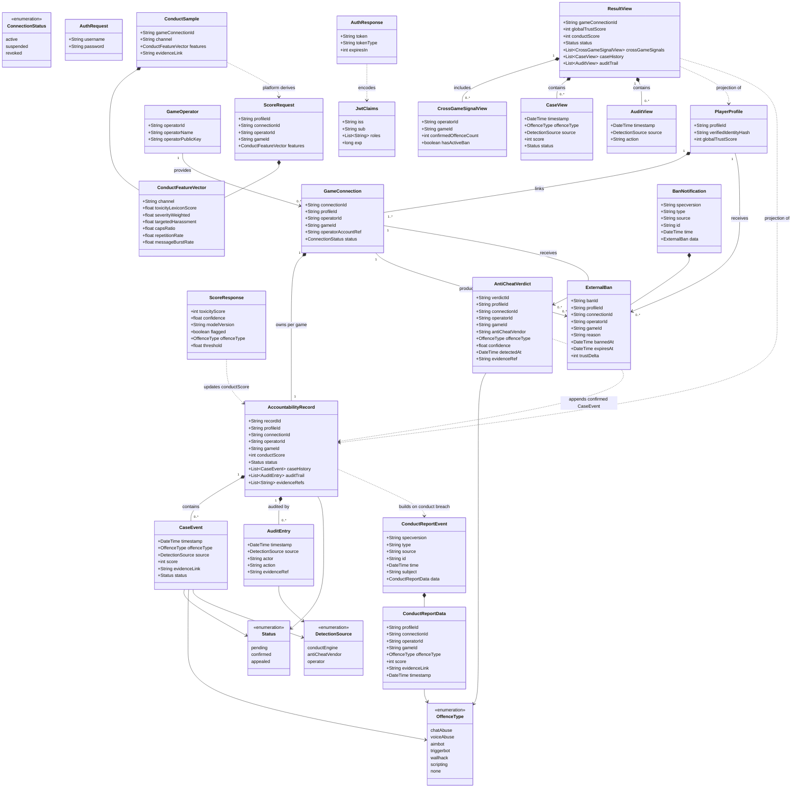

# Data Model

The data structures that flow through the platform, who **owns** each one, and the
**contracts** for every message on the [[Architecture-Overview#System diagram|system diagram]].
Model baseline: **one verified profile** linked to **many game/operator accounts**, with
**per-game case history** and a **global trust score** shared across games.

## Class diagram



## Data ownership (which service owns what)

| Data structure | Owner | Persisted? | Notes |
|----------------|-------|-----------|-------|
| `ConductFeatureVector`, `ScoreRequest`, `ScoreResponse` | [[ml-module]] (detection-engine) | No — **stateless** | Pure request/response of the conduct scorer. |
| `PlayerProfile`, `GameOperator`, `GameConnection`, `ConnectionStatus` | [[platform-module]] (accountability-service) | **Yes** — Postgres (+ Flyway) | Identity/account graph: one verified profile linked to many game/operator accounts (one account per game/operator pair). |
| `AccountabilityRecord`, `CaseEvent`, `AuditEntry`, `Status`, `OffenceType`, `DetectionSource` | [[platform-module]] (accountability-service) | **Yes** — Postgres (+ Flyway) | Per-game accountability spine: one record per game connection, each with its own offence/case history **and append-only audit trail**. |
| `AntiCheatVerdict` | [[platform-module]] | Ingested → persisted as a `CaseEvent` (+ audit) | External anti-cheat pushes a verdict (`POST /anti-cheat-verdicts`); recorded **auto-confirmed, appealable** ([[Anti-Cheat-Integration]]). |
| `ExternalBan`, `BanNotification` | [[platform-module]] | `ExternalBan` persisted, `BanNotification` ingested event/API payload | Operator ban outcomes are fed back into the platform (via `POST /ban-notifications`) and update global trust (`trustDelta`). |
| `AuthRequest`, `AuthResponse`, `JwtClaims`, `ConductSample` | [[platform-module]] | No (token is stateless JWT) | Web↔platform boundary DTOs; `JwtClaims.iss` = `JWT_ISSUER`. |
| `ConductReportEvent`, `ConductReportData` | [[platform-module]] | Emitted to Kafka | The [[Cheat-Report-Event|conduct-report CloudEvent]] join point. |
| `ResultView`, `CaseView`, `AuditView`, `CrossGameSignalView` | [[web-module]] (player-portal) | No | Read-only projection: selected game history + audit trail + global trust/cross-game signals. |

> **Privacy rule:** identity is always a **hashed token** (`profileId` / `subject`);
> evidence is always a **secure link**, never raw. See [[Identity-Model]].

## Contract 0 — `POST /auth` (web → platform)

**Status: built** (accountability-service). Credentials are checked against a `user_credential`
table (bcrypt hashes only — raw passwords never stored); a valid login mints a stateless RS256
JWT. A dev-only keypair lives under `resources/jwt` (prod injects real keys via the same
`smallrye.jwt.sign.key.location` / `mp.jwt.verify.publickey.location` properties). The
account-creating identity/age verification that *produces* a credential is still designed, not
built — a demo login is seeded in dev/test only.

Login exchange. The browser sends credentials; the platform returns a **stateless JWT**
that authorises every later call. The token's `sub` is the **hashed** profile id — the
raw identity is never in the token. `iss` comes from the `JWT_ISSUER` env key.

**Request** (`AuthRequest`):
```json
{ "username": "player@example.com", "password": "<secret>" }
```

**Response** (`AuthResponse`):
```json
{ "token": "<jwt>", "tokenType": "Bearer", "expiresIn": 3600 }
```

**Decoded JWT payload** (`JwtClaims`):
```json
{
  "iss": "trust-platform",
  "sub": "sha256:<hashedProfileId>",
  "roles": ["player"],
  "exp": 1767225600
}
```

> All subsequent requests send `Authorization: Bearer <jwt>`. Identity/age-assurance
> verification that *produces* the account is **designed, not built** — see [[Identity-Model]].
>
> **Identity resolution:** the backend `ProfileIdResolver` uses the JWT `sub` as the profile id.
> Production is **JWT-only**; the interim `X-Profile-Id` header is honoured **only** in the `dev`
> and `test` profiles (`accountability.auth.allow-header-fallback`), so a header can never be used
> to impersonate a profile. The `player-portal` sends the JWT as `Authorization: Bearer <token>`;
> the `X-Profile-Id` fallback remains available only for dev/test curl requests.

## Contract 1 — `POST /score` (platform → ml)

**Request** (`ScoreRequest`):
```json
{
  "profileId": "sha256:<hashedProfileId>",
  "features": {
    "channel": "text",
    "toxicityLexiconScore": 0.88,
    "severityWeighted": 0.74,
    "targetedHarassment": 0.69,
    "capsRatio": 0.55,
    "repetitionRate": 0.40,
    "messageBurstRate": 0.62
  }
}
```

**Response** (`ScoreResponse`):
```json
{
  "toxicityScore": 92,
  "confidence": 0.87,
  "flagged": true,
  "offenceType": "chatAbuse",
  "threshold": 0.62,
  "modelVersion": "conduct-rf-v1"
}
```

> `flagged` is the actual decision: `P(toxic) >= threshold`, where `threshold` is the
> tuned operating point (recall>=85% / FPR<5%, see [[Evaluation]]) persisted in the model
> artifact — not a naive 0.5. The platform stores `flagged` to drive `Status = pending`.

> `offenceType` names the conduct archetype (`chatAbuse | voiceAbuse`) when `flagged`,
> otherwise `none`. The platform maps it onto `OffenceType` and stores it on a `CaseEvent`
> with `source = conductEngine`, so the report to the operator carries the real offence.
> **Cheat** offences (`aimbot`, `wallhack`, …) never come from `/score` — they are ingested
> from external anti-cheat ([[Anti-Cheat-Integration]]).

> `ConductFeatureVector` fields map to the feature families in [[Features]]. In the current
> experiment, values are generated numerical proxies; no raw text, transcript or audio is
> processed. `channel` is synthetic `text` or `voice` metadata, and the simulated voice rows
> receive additional numerical noise. Each proxy and its limitations are described in
> [[Features]]; the models that consume them are compared in [[Models]].
>
> | Feature | Channel | Suspicious when | Captures |
> |---------|---------|-----------------|----------|
> | `toxicityLexiconScore` | text/voice | **high** | weighted presence of abusive/hateful terms |
> | `severityWeighted` | text/voice | **high** | severity of the worst terms, not just count |
> | `targetedHarassment` | text/voice | **high** | directed-at-a-person signals (slurs + 2nd person) |
> | `capsRatio` | text | **high** | shouting / aggression proxy |
> | `repetitionRate` | text/voice | **high** | spammed abuse / pile-on |
> | `messageBurstRate` | text/voice | **high** | rapid aggressive bursts vs normal pacing |

## Contract 2 — Accountability Record (platform ↔ Postgres)

Full schema and status lifecycle: [[Accountability-Record]].
```json
{
  "profileId": "sha256:…",
  "connectionId": "gc-123",
  "operatorId": "op-1",
  "gameId": "game-a",
  "conductScore": 92,
  "status": "pending",
  "caseHistory": [
    {
      "timestamp": "2026-01-01T12:00:00Z",
      "offenceType": "chatAbuse",
      "source": "conductEngine",
      "score": 92,
      "evidenceLink": "https://evidence.example/secure/<ref>",
      "status": "pending"
    },
    {
      "timestamp": "2026-01-03T09:00:00Z",
      "offenceType": "aimbot",
      "source": "antiCheatVendor",
      "score": 100,
      "evidenceLink": "https://evidence.example/secure/<ref2>",
      "status": "confirmed"
    }
  ],
  "auditTrail": [
    { "timestamp": "2026-01-01T12:00:00Z", "source": "conductEngine", "action": "flagged pending", "evidenceRef": "<ref>" },
    { "timestamp": "2026-01-03T09:00:00Z", "source": "antiCheatVendor", "action": "verdict auto-confirmed", "evidenceRef": "<ref2>" }
  ],
  "evidenceRefs": ["https://evidence.example/secure/<ref>"]
}
```

> Scope: this record is **per game connection**. Cross-game visibility is provided via
> [[#Contract 5 — results view platform → web|`crossGameSignals`]], while trust remains global at profile level.
> Each `CaseEvent` carries its `source` (`conductEngine` | `antiCheatVendor` | `operator`) and every
> change is mirrored in the append-only `auditTrail`.

## Contract 3 — Conduct-Report CloudEvent (platform → Kafka → operator)

Full envelope: [[Cheat-Report-Event|Offence Reporting & Anti-Cheat Ingest]].
- **type:** `com.trustplatform.conduct.reported`
- **subject:** hashed profile id
- **data:** `{ offenceType, score, evidenceLink, timestamp }` (conduct offence: `chatAbuse` | `voiceAbuse`)
- **delivery:** once (idempotent consumer).

## Contract 3b — `POST /anti-cheat-verdicts` (anti-cheat → platform)

How a third-party anti-cheat (or the in-module simulated vendor) **pushes a cheat verdict** into
the platform. The platform records it as an **auto-confirmed, appealable** `CaseEvent`
(`source = antiCheatVendor`), appends an audit entry, and updates global trust. Full behaviour:
[[Anti-Cheat-Integration]].

**Request** (`AntiCheatVerdict` as body):
```json
{
  "verdictId": "acv-2026-001",
  "profileId": "sha256:<hashedProfileId>",
  "connectionId": "gc-123",
  "operatorId": "op-1",
  "gameId": "game-a",
  "antiCheatVendor": "vendor-eac",
  "offenceType": "aimbot",
  "confidence": 0.98,
  "detectedAt": "2026-01-03T09:00:00Z",
  "evidenceRef": "https://evidence.example/secure/<ref2>"
}
```

**Response**:
```json
{
  "status": "recorded",
  "verdictId": "acv-2026-001",
  "profileId": "sha256:<hashedProfileId>",
  "caseStatus": "confirmed",
  "globalTrustScore": 38,
  "crossGameSignalsUpdated": true
}
```

> Security/privacy: `profileId` remains hashed; the vendor submits only the minimum fields
> needed for accountability. Detection is **not** re-run — the vendor's verdict is trusted,
> and the player may appeal afterwards ([[Governance]]).

## Contract 3a — `POST /ban-notifications` (operator → platform)

How a game operator reports a final enforcement outcome back to the platform.
The payload is scoped to one game/operator connection, and the platform then
persists `ExternalBan`, updates `globalTrustScore`, and refreshes cross-game
warning summaries for all linked games.

**Request** (`BanNotification.data` as body):
```json
{
  "banId": "ban-2026-001",
  "profileId": "sha256:<hashedProfileId>",
  "connectionId": "gc-123",
  "operatorId": "op-1",
  "gameId": "game-a",
  "reason": "aimbot confirmed",
  "bannedAt": "2026-01-02T10:15:00Z",
  "expiresAt": "2026-02-02T10:15:00Z",
  "trustDelta": -15
}
```

**Response**:
```json
{
  "status": "accepted",
  "banId": "ban-2026-001",
  "profileId": "sha256:<hashedProfileId>",
  "globalTrustScore": 46,
  "crossGameSignalsUpdated": true
}
```

> Security/privacy: `profileId` remains hashed; operators submit only the minimum
> fields needed for accountability propagation.

## Contract 4 — `POST /samples` (web → platform)

How a conduct sample enters the pipeline. In the current prototype, the browser submits an
**already-featurised synthetic** `ConductFeatureVector`; the web tier does **no** feature
engineering. Any `evidenceLink` used in the demo is a synthetic reference, not a link to real
chat or voice evidence. The platform then derives the
[[#Contract 1 — POST /score platform → ml|`ScoreRequest`]] (adding the hashed `profileId` from the
JWT `sub`) and calls the conduct scorer.

**Request** (`ConductSample`, `Authorization: Bearer <jwt>`):
```json
{
  "channel": "text",
  "features": {
    "channel": "text",
    "toxicityLexiconScore": 0.88,
    "severityWeighted": 0.74,
    "targetedHarassment": 0.69,
    "capsRatio": 0.55,
    "repetitionRate": 0.40,
    "messageBurstRate": 0.62
  },
  "evidenceLink": "https://evidence.example/secure/<ref>"
}
```

**Response:** the updated [[#Contract 5 — results view platform → web|`ResultView`]] —
per-game fields (`conductScore`, `status`, `caseHistory`, `auditTrail`) reflect only the submitted
`gameConnectionId`, while `globalTrustScore` and `crossGameSignals` reflect profile-wide state.

> This prototype demonstrates the scoring boundary with synthetic feature values and does not
> process raw chat, transcripts or audio. A real deployment would need to define and assess a
> separate server-side feature-extraction and evidence-handling design before processing
> communications; this is not implemented here ([[Synthetic-Data]]).

## Contract 5 — results view (platform → web)

The read-only projection the UI renders (a subset of the [[Accountability-Record]] —
no `evidenceRefs`, no raw fields). It combines one selected game's detailed history with
profile-level trust and cross-game warning summaries, and shows the **audit trail** with each
entry's source.

**Response** (`ResultView`):
```json
{
  "globalTrustScore": 61,
  "conductScore": 92,
  "status": "pending",
  "crossGameSignals": [
    {
      "operatorId": "op-2",
      "gameId": "game-b",
      "confirmedOffenceCount": 3,
      "hasActiveBan": true
    }
  ],
  "caseHistory": [
    {
      "timestamp": "2026-01-01T12:00:00Z",
      "offenceType": "chatAbuse",
      "source": "conductEngine",
      "score": 92,
      "status": "pending"
    },
    {
      "timestamp": "2026-01-03T09:00:00Z",
      "offenceType": "aimbot",
      "source": "antiCheatVendor",
      "score": 100,
      "status": "confirmed"
    }
  ],
  "auditTrail": [
    { "timestamp": "2026-01-01T12:00:00Z", "source": "conductEngine", "action": "flagged pending" },
    { "timestamp": "2026-01-03T09:00:00Z", "source": "antiCheatVendor", "action": "verdict auto-confirmed" }
  ]
}
```

> Same shape backs both **GET** (fetch current results/case/audit history) and the **response
> to `POST /samples`**. Per-game fields stay scoped to the selected connection; global
> trust/cross-game summaries aggregate across all linked connections. Case/audit history may be
> paginated later; MVP returns the full list.

## `OffenceType` values

The platform's accountability model spans two offence **categories**, by **detection source**.
The first is **detected by the built engine**; the second is **ingested from external
anti-cheat** — both are recorded, audited and governed identically.

### Conduct offences — classified from synthetic numerical features
Produced by [[ml-module]] from synthetic text/voice channel feature rows; these are the only values the built
[[Cheat-Report-Event|conduct-report CloudEvent]] ever emits. Created `pending` → human review.

| Value | Meaning | Channel it flags |
|-------|---------|------------------|
| `chatAbuse` | Synthetic sample labelled as toxic / abusive **text** conduct | Synthetic `text` channel |
| `voiceAbuse` | Synthetic sample labelled as toxic / abusive **voice** conduct | Synthetic `voice` channel |
| `none` | Clean — no offence | — |

### Cheat offences — ingested from external anti-cheat (NOT detected here)
Pushed in by a third-party anti-cheat via [[Anti-Cheat-Integration|`POST /anti-cheat-verdicts`]].
Recorded **auto-confirmed** (vendor trusted) and **appealable**. The built engine never produces
these.

| Value | Meaning | Detection (external) |
|-------|---------|----------------------|
| `aimbot` | Assisted aim / instant snaps | Third-party anti-cheat |
| `triggerbot` | Auto-fire on target | Third-party anti-cheat |
| `wallhack` | Seeing through geometry / ESP | Third-party anti-cheat |
| `scripting` | Macro / Zen scripted input | Third-party anti-cheat |

> **Why separated by source:** conduct detection is *linguistic/acoustic* (the empirical core
> built here); cheat detection is *behavioural/kernel* and delegated to specialist vendors.
> Tagging every `CaseEvent` with its `source` (`conductEngine` | `antiCheatVendor` | `operator`)
> keeps the record honest and powers the **detection-source asymmetry** critique in [[Governance]].

## Player self-service: connections, bans, appeals, trust history

The portal added player-owned flows on top of the core record. New persisted entities and the
contracts that serve them:

### `GameConnection` (player-linked games)
Players link games themselves from the **Games** tab, so connections are created lazily (the
`PlayerProfile` is created on first link). Each connection carries display metadata for the UI.

| Field | Meaning |
|-------|---------|
| `connectionId` | Stable id for the link (`gc-…`). |
| `gameId` / `gameName` | Catalogue id + display name (real names, never "Game A"). |
| `provider` | Launcher/source (`steam`, `epic`, `riot`, `battlenet`, …) — drives logo choice. |
| `imageUrl` | Steam cover art when available; else the launcher brand mark renders. |
| `status` | `active` / `suspended` / `revoked`. A ban does **not** remove the connection. |

- `GET /connections` · `POST /connections` (link) · `DELETE /connections/{id}` (unlink).
- `GET /games/search?q=` — live catalogue (Steam store search + curated non-Steam set).

### `ExternalBan` (operator-declared sanctions)
Recorded when an operator ban is fed back (or dev-simulated). The operator — not the platform —
sets the type and appealability.

| Field | Meaning |
|-------|---------|
| `banType` | `communication` / `temporary` / `permanent`. |
| `durationDays` | Extent for time-boxed bans; null = permanent. |
| `appealable` | Operator-set; false ⇒ read-only, rejected by the appeal endpoints. |

- `GET /bans` → active bans with type, extent and appealability for the record view.
- Dev: `POST /dev/bans/simulate` (demo-only).

### `Appeal`
Lifecycle object for challenging an appealable sanction; overturning one **restores** the trust
that sanction removed. Non-appealable bans are excluded from the appealable list and rejected on
submit.

### `TrustHistory` (trust over time)
Append-only points powering the trust-over-time graph. Always anchored at **100 on account
creation** (`PlayerProfile.createdAt`, DB-defaulted), with a point appended on every trust change
(`ban`, `anti-cheat`, `appeal-overturned`).

- `GET /trust-history` → `[{ occurredAt, score, reason }]`: `account_created@100` → each change →
  `current@<score>`. Range filtering (1Y / 5Y / lifetime) is done client-side on the full series.

### `ResultView` additions
`linkedGamesCount` and `activeBanCount` (counted from real connections/bans so linked-games no
longer collapses to 0 after a ban resolves), plus `gameProvider` / per-signal `provider` for logos.

### Age assurance & guardian-controlled accounts
`PlayerProfile` carries the account's age-access state (see [[Age-Assurance]]):

| Field | Meaning |
|-------|---------|
| `accountType` | `ADULT` or `GUARDIAN_MINOR`. DB-defaults to `ADULT` so lazily-created profiles are adult. |
| `holderName` | The account holder's display name (the child, for a guardian account). |
| `guardianName` / `guardianEmail` | The vouching adult guardian (guardian accounts only). |
| `matureAccessAllowed` | Whether the account may link 18+ titles. Adults: true; minors: guardian's choice. |

- Set at `POST /auth/register` from the self-declared `over18` + guardian details; **no date of
  birth is stored** (the DOB is used only by the portal's mocked ID check).
- `GET /profile` → `ProfileView` (type, guardian, 18+ access) — account-level, works with no
  connections. `POST /profile/verify-adult` converts a guardian-controlled account to adult on
  coming of age.
- `POST /connections` carries a best-effort `mature` flag; the server rejects (403) a mature link
  for a guardian-controlled account without `matureAccessAllowed`.

## Related
- [[Architecture-Overview]]  [[Accountability-Record]]  [[Cheat-Report-Event]]  [[Anti-Cheat-Integration]]
- [[Game-Operator-Integration]]
- [[Features]]  [[Models]]  [[Identity-Model]]
